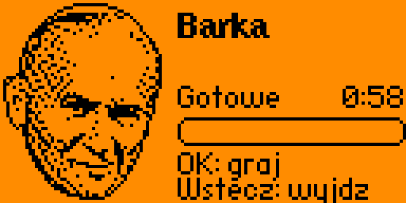
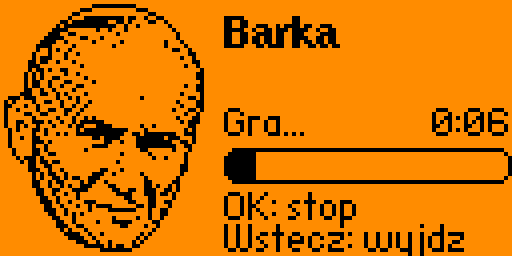
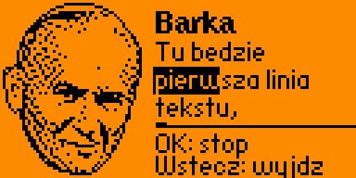

# Barka na Flipperze

Aplikacja `.fap` na Flipper Zero: portret papieża, a po naciśnięciu OK
Flipper gra na głośniczku melodię „Barki” (pierwsza zwrotka z refrenem,
ok. 1 minuty). Projekt uczelniany.

| Gotowe do grania | Podczas grania |
|---|---|
|  |  |

*Zrzuty ekranu z Flippera z firmware Momentum.*

## Obsługa

| Przycisk | Działanie |
|---|---|
| OK | graj / stop |
| Wstecz | wyjście (zatrzymuje melodię) |

Na ekranie: stan („Gotowe” / „Gra...”), czas (długość melodii albo ile już
zagrano) i pasek postępu.

Dźwięk idzie przez serwis powiadomień Flippera, więc uwzględnia głośność
ustawioną w **Settings → Notifications** i tryb cichy (Stealth). Głośnik gra
jeden dźwięk naraz, dlatego melodia jest jednogłosowa.

## Instalacja

Skopiuj `barka.fap` na kartę microSD do `/ext/apps/Tools/` (np. przez
qFlipper) i uruchom z **Apps → Tools → Barka**.

Gotowy plik powstaje w `dist/` po zbudowaniu (niżej). Aplikacja buduje się na
oficjalne firmware (sprawdzone na 1.5.1, API 88.2) i na Momentum (mntm-012,
API 87.1) - plik `.fap` trzeba zbudować pod firmware, które masz na Flipperze.

## Budowanie

Potrzebny [uFBT](https://github.com/flipperdevices/flipperzero-ufbt):

```sh
ufbt                       # oficjalne firmware
UFBT_HOME=~/.ufbt-mntm ufbt   # Momentum (SDK pobrany wcześniej przez ufbt update)
```

## Melodia

Melodia jest w `melodia_barka.h`, wygenerowanym z pliku karaoke
[`karaoke/barka.kar`](karaoke/README.md) narzędziem `narzedzia/midi_na_nuty.py`:

```sh
python3 narzedzia/midi_na_nuty.py karaoke/barka.kar --info
python3 narzedzia/midi_na_nuty.py karaoke/barka.kar -o melodia_barka.h --do 63.4 --transpozycja 12 --legato
```

- `--info` opisuje kanały pliku; przy plikach karaoke pokazuje też, ile sylab
  tekstu trafia w nuty danego kanału - kanał melodii śpiewanej trafia we
  wszystkie.
- Bez `--kanal` narzędzie samo wybiera kanał melodii (po sylabach tekstu, a bez
  tekstu - kanał o najwyższych dźwiękach). Gdy w jednej chwili brzmi kilka
  dźwięków, zostaje najwyższy.
- `--od` / `--do` wycinają fragment (w sekundach), `--transpozycja 12` gra
  oktawę wyżej - na małym głośniku wyższe dźwięki brzmią wyraźniej.
- `--legato` dokleja do nut krótkie pauzy, które w plikach karaoke robią
  z melodii staccato.
- `--tryb dominujacy` jest dla plików MIDI zrobionych automatycznie z nagrania
  audio (dziesiątki nut na sekundę). Działa heurystycznie i daje wyraźnie
  gorszy wynik niż porządny plik MIDI.

Plik karaoke jest w repo w folderze `karaoke/`; pliki `.mid` / `.midi` zostają
lokalnie (są w `.gitignore`). Bez `melodia_barka.h` aplikacja
gra przykład z domeny publicznej - „Wlazł kotek na płotek”
(`melodia_przyklad.h`).

## Tekst do melodii

Jeśli na karcie jest plik `/ext/apps_data/barka/tekst.txt`, aplikacja podczas
grania pokazuje bieżącą linię tekstu i podświetla śpiewaną sylabę. Każda
zwrotka z pliku to jedno przejście melodii. Bez pliku aplikacja działa jak
wyżej. Tekst powstaje przy budowaniu z pliku karaoke w `karaoke/` (zobacz
niżej) albo przygotowujesz go sama.



*Zrzut z Flippera z tekstem zastępczym.*

### Format pliku

UTF-8, jeden plik na całą piosenkę:

- każda niepusta linia to jedna linia na ekranie (długie linie są zawijane
  do trzech wierszy obok portretu),
- spacje dzielą słowa, `-` dzieli słowo na sylaby; **każda sylaba przypada na
  kolejną nutę** melodii (pauzy się nie liczą),
- `_` przedłuża poprzednią sylabę o jedną nutę - osobno (`la _ la`) albo
  w słowie (`ko-_-tek`); `_` na początku zwrotki to nuta bez tekstu,
- `~` to spacja wewnątrz sylaby, gdy na jednej nucie są dwa krótkie słowa
  (`i~do`),
- pusta linia zaczyna nową zwrotkę - melodia gra od początku,
- linie zaczynające się od `#` to komentarze,
- polskie litery są zamieniane na łacińskie (font Flippera ich nie ma).

Przykład dla melodii przykładowej: [przyklady/wlazl_kotek.txt](przyklady/wlazl_kotek.txt).

### Tekst z karaoke przy budowaniu

Plik karaoke leży w folderze [`karaoke/`](karaoke/README.md), więc wystarczy
zbudować aplikację (`ufbt`). Przy budowaniu `application.fam` uruchamia
`narzedzia/kar_na_tekst.py`, które dopasowuje sylaby z pliku karaoke do nut
`melodia_barka.h` i zapisuje `pliki/tekst.txt`. Plik trafia do środka
`barka.fap` - wystarczy wgrać sam `.fap`. Folder `pliki/` jest wynikiem
budowania i jest w `.gitignore`.

Aplikacja szuka tekstu najpierw w `/ext/apps_data/barka/tekst.txt` (plik
wgrany ręcznie ma pierwszeństwo), potem w tekście dołączonym do `.fap`.

### Tekst z karaoke ręcznie

To samo narzędzie można uruchomić samodzielnie, także z wgraniem na Flippera:

```sh
python3 narzedzia/kar_na_tekst.py karaoke/barka.kar -o tekst.txt --melodia melodia_barka.h \
    --wgraj /dev/cu.usbmodemflip_NAZWA
```

`--melodia` liczy nuty jednej zwrotki z nagłówka melodii (zamiast tego można
podać `--nut-w-zwrotce 72`). `--wgraj` wymaga pyserial; bez niego skopiuj
`tekst.txt` przez qFlipper do `/ext/apps_data/barka/`. Aplikacja czyta tekst
przy starcie.

## Testy

```sh
make -C tests                                # logika aplikacji (C, ASan/UBSan)
python3 -m unittest discover -s tests -v     # narzędzia MIDI i tekstu
```

Testy w C sprawdzają częstotliwości nut, czasy trwania, odtwarzacz (włączanie
i wyłączanie dźwięku, odstępy między nutami, koniec melodii, zwrotki,
przepełnienie licznika czasu), portret, parser tekstu (sylaby, zwrotki,
przedłużenia, polskie litery, limity) i zawijanie linii, a także czy wbudowana
melodia jest poprawna i mieści się w zakresie głośnika. Testy narzędzi budują
pliki MIDI w pamięci, kompilują wygenerowany nagłówek i sprawdzają, że plik
tekstu z `kar_na_tekst.py` czyta parser aplikacji.

## Narzędzia

- `narzedzia/midi_na_nuty.py` - MIDI / karaoke → `melodia_barka.h`
- `narzedzia/kar_na_tekst.py` - karaoke → `tekst.txt` (opcjonalnie od razu na Flippera)
- `narzedzia/zrzut.py` - zrzut ekranu Flippera przez USB (RPC); opcje `--ok`
  i `--back` najpierw naciskają przycisk

## Licencja

[PolyForm Noncommercial 1.0.0](LICENSE) - projekt uczelniany, wykorzystanie
komercyjne jest zabronione.
